# VortexPak

**Format-aware game asset archiver, GPU texture codec and seekable VFS — Rust core, Python/C-ABI interface.**

[](https://github.com/ExTynT/vortexpak/actions/workflows/ci.yml)
[](LICENSE)

Packs game assets into a seekable archive. Strict mode preserves original file bytes; engine mode can store lossy GPU-native BC1/BC7 textures. Storage-only BCX requires load-time decoding. Performance and quality claims require the separate, reproducible benchmark tracks below.

## Quick start

```powershell
pip install .          # builds the Rust core via cargo
vortexpak pack ./game game.vpak --gpu auto
vortexpak info game.vpak
vortexpak extract game.vpak textures/hero.png -o hero.png
```

```python
from vortexpak import VortexPakCodec, VortexVFS

arch = VortexPakCodec(mode="engine", gpu="auto").encode_directory("game/")
open("game.vpak", "wb").write(arch.to_bytes())

with VortexVFS.open("game.vpak") as vfs:
    blocks = vfs.read_bytes("textures/hero.png", materialize_full_rgba=False)
```

## Benchmarks

Competitive comparisons use the [versioned v2 protocol](docs/BENCHMARKING.md) and
`benchmarks/protocol.json`. The source of truth is a validated immutable evidence
bundle, not its PNG/HTML rendering. Historical v1 reports remain unchanged.
Lossless archives and lossy texture quality are separate tracks. No solid archive
is compared only against per-file compression; no opaque alpha inflates RGB PSNR.

~~~powershell
pip install -e ".[benchmark,quality]"
python benchmarks/protocol.py build --output ./benchmark-build
python benchmarks/run_reference.py --corpus-root ../vortex_corpus --output ./benchmark-v2 --receipt ./benchmark-build/receipt.json
~~~

The archive matrix includes VortexPak strict, solid tar+zstd (3/9/19), solid
LZ4, ZIP stored/DEFLATE, indexed 2 MiB zstd and per-file zstd. Every original
file must restore byte-for-byte (SHA-256), on every measured trial.

Reports retain randomized repeated trials, CPU budgets, wall/CPU time, throughput,
sampled RSS, raw latency distributions, deadline misses, size buckets, bootstrap
intervals, environment and input/source hashes. Codec-cache reset is **not cold
OS/disk IO**. The runners reject incomplete or changing inputs rather than
silently sampling. There is no aggregate winner score.

[Graphical measured report](benchmarks/reports/index.html) and [raw experiment folders](benchmarks/reports/) cover only their named complete corpora,
not all games or hardware. Historical charts/results from the older runners use
a different, exploratory protocol and are not a validated competitive scoreboard.

The legacy capability matrix (`benchmarks/quality_matrix.py`) describes features, not a measured head-to-head comparison with Oodle/Basis/NVTT.

## How it works

1. **Format-aware lane packing** — assets are routed to semantic lanes (textures, structured data, scripts, media, 3D) sorted to maximize cross-file matches, then compressed with the proprietary **VXLZ-ANS** codec (Rust, Rayon-parallel) or zstd.
2. **Lane dictionaries** — repetitive text lanes get a dictionary trained on their own content ([format spec](docs/FORMAT.md) strategies 9/10); blocks are re-emitted as dictionary-seeded zstd frames only when measurably smaller. Random access preserved.
3. **VXTX-GPU block compression** — PNG/TGA/JPG → BC1 / BC4 / BC5 / BC7 (mode 6), bit-exact to the D3D11/Vulkan spec (checked against a reference decoder in CI). BC1 fit: multi-axis seeding, least-squares endpoint refinement (Giesen 2017), greedy 565 polish, AVX2 evaluation; closed-loop RDO optimizes post-codec error. `--gpu auto` takes the cheapest GPU-native format (BC1, then BC7) whose color PSNR (RGB, alpha excluded) and alpha PSNR reach `--gpu-min-psnr` (default 35 dB); opaque textures must stay exactly opaque. Below the floor the texture is stored losslessly instead — auto never ships a texture under it. Explicit `--gpu bc1|bc5|bc7|bcx` always uses that format. GPU-native textures carry a full mip chain (sRGB-correct box filter; `--no-mips` for UI/pixel art) and an sRGB/linear tag, so they upload as-is; `vortexpak extract --dds` writes any of them as a standard DDS. Opt-in BCX mixes BC1/BC7 per block for disk size (decoded at load).
4. **Seekable VFS** — 16-block LRU cache, per-block decompression, XXH3-64 integrity on every asset. Decoder rejects tested corrupt inputs (adversarial tests); this is not a proof against all malformed archives.
5. **C-ABI** — `vortexpak_native/vortexpak.h` (cbindgen-generated, CI-verified) exposes transforms, parallel decoders, BCn codecs and a native VFS for engines without Python ([examples/c/consumer.c](examples/c/consumer.c)).

**Lossless contract.** `--mode strict` restores every original byte; it rejects `--rdo` and `--gpu`, which are lossy and require `--mode engine`.

**Block layout.** The default `--layout stream` gives every asset of 64 KiB or more its own block(s) and packs smaller assets into ~256 KiB blocks, so one random read never decodes unrelated bulk. `--layout compact` keeps larger shared blocks for more cross-asset context and a slightly smaller archive. Both decode with the same reader.

## Roadmap

<!-- roadmap:start: generated by tools/roadmap.py from docs/roadmap.json, edit there -->

### 🎯 North Star: Xonotic −40 %

> **Ship the complete Xonotic 0.8.6 release in 40 % fewer bytes, from one .vpak: the same game on a real GPU, no slower to load, rebuilt in seconds after an edit — every number reproducible with one command.**

| Gate | Target | Today |
|---|---|---|
| **Size** | ≤ 711 MB for all 14,597 files (≤ 0.60× of the 1,185.2 MB shipped pk3 download) | 924.6 MB byte-exact (0.780×, compact layout, VXCM backend), every file SHA-256 verified; compact single-file reads p99 373 ms. 27 % of the download is already-compressed .jpg/.ogg, so lossless alone stops far above 711 MB. |
| **Exact** | Every non-texture file byte-identical (SHA-256); JPEG recompression bit-exact | Strict mode verified byte-exact on all 14,597 files |
| **Texture quality** | Every re-encoded DXT texture ≥ 40 dB RGB and alpha against the shipped texture, on every mip level | Shipped .dds (DXT1 982 MB, DXT5 621 MB raw) are opaque data; no DDS ingest, no BC3 (DXT5) encoder, no RDO for existing blocks |
| **Real game** | Stock Xonotic 0.8.6 runs from the .vpak through a DarkPlaces filesystem backend on a real GPU: every official map loads, a recorded demo plays to the end, zero missing assets | No engine backend; never run on a GPU |
| **Load speed** | No map loads slower than from the shipped pk3 files (median of 7 runs); single-asset read p99 ≤ 1 ms | Not measured; VXLZ decodes 2.4–4.6× slower than zstd on the same blocks |
| **Iteration** | Changing one texture rebuilds the archive in ≤ 5 s on 8 cores; the resulting patch is ≤ 2× that asset’s compressed size | Full repack only: 18.0 s (stream) / 250.2 s (compact) on 16 workers; patch size not measured |

Every gate must hold at once, in one reproducible run. [Baseline evidence](benchmarks/reports/v2/north-star/BASELINE.md)

**Progress:** 9 of 24 milestones done (38 %) `████████░░░░░░░░░░░░`

```mermaid
flowchart LR
  classDef done fill:#2da44e,stroke:#1a7f37,color:#ffffff
  classDef active fill:#bf8700,stroke:#9a6700,color:#ffffff
  classDef next fill:#0969da,stroke:#0550ae,color:#ffffff
  classDef planned fill:#f6f8fa,stroke:#8c959f,color:#57606a,stroke-dasharray:4 3
  subgraph P1["1 · Trustworthy foundation"]
    direction TB
    M1["✅ M1 · Spec-conformant GPU blocks"]:::done
    M2["✅ M2 · Hardened container"]:::done
    M3["✅ M3 · Portable builds"]:::done
    M4["✅ M4 · Reproducible benchmark"]:::done
  end
  subgraph P2["2 · Quality and streaming guarantees"]
    direction TB
    M5["✅ M5 · Byte-exact strict mode"]:::done
    M6["✅ M6 · Texture quality floor"]:::done
    M7["✅ M7 · Stream block layout"]:::done
    M23["✅ M23 · Lossless Xonotic 0.80×"]:::done
    M24["🔜 M24 · Seekable compact archive"]:::next
  end
  subgraph P3["3 · Engine-ready textures"]
    direction TB
    M8["✅ M8 · Mips, sRGB, DDS"]:::done
    M20["🔜 M20 · DXT ingest"]:::next
    M21["⬜ M21 · RDO for shipped DXT"]:::planned
    M9["⬜ M9 · Normal maps"]:::planned
    M10["⬜ M10 · Full BC7"]:::planned
    M11["⬜ M11 · KTX2 export"]:::planned
    M12["⬜ M12 · Mobile formats"]:::planned
  end
  subgraph P4["4 · Engine integration"]
    direction TB
    M13["🔜 M13 · Complete C-ABI"]:::next
    M14["⬜ M14 · DarkPlaces backend"]:::planned
    M15["⬜ M15 · Real-GPU validation"]:::planned
  end
  subgraph P5["5 · Production pipeline"]
    direction TB
    M22["⬜ M22 · Lossless JPEG recompression"]:::planned
    M16["⬜ M16 · Incremental repack"]:::planned
    M17["⬜ M17 · Patch-friendly archives"]:::planned
    M18["⬜ M18 · Faster VXLZ decode"]:::planned
    M19["⬜ M19 · Cold-disk benchmark"]:::planned
  end
  P1 --> P2 --> P3 --> P4 --> P5
```



✅ done · 🚧 in progress · 🔜 next · ⬜ planned

<details>
<summary><b>Phase 1 · Trustworthy foundation</b> · 4/4 ✅</summary>

- [x] **M1 · Spec-conformant GPU blocks** — BC1/BC4/BC5/BC7 blocks decode bit-exactly with an independent reference decoder (Pillow DDS). *(2026-10-25)* · [evidence](tests/test_bcn.py)
- [x] **M2 · Hardened container** — Corrupt or truncated archives raise a clean error; adversarial fuzz tests in Python and Rust. *(2026-10-25)* · [evidence](tests/test_robustness.py)
- [x] **M3 · Portable builds** — pip-installable package with the Rust core; CI on Windows, Linux and macOS plus a pure-NumPy fallback. *(2026-10-25)* · [evidence](.github/workflows/ci.yml)
- [x] **M4 · Reproducible benchmark** — Receipted builds, hash-chained raw evidence and a qualified 1-CPU reference run. *(2026-10-26)* · [evidence](benchmarks/reports/v2/full-9800x3d-r3/RESULTS.md)

</details>

<details open>
<summary><b>Phase 2 · Quality and streaming guarantees</b> · 4/5 🚧</summary>

- [x] **M5 · Byte-exact strict mode** — `--mode strict` restores every byte and rejects the lossy `--rdo` and `--gpu` options. *(2026-10-26)* · [evidence](tests/test_bcn.py)
- [x] **M6 · Texture quality floor** — `--gpu auto` never ships a texture below the floor (default 35 dB RGB) or with altered opaque alpha. *(2026-10-26)* · [evidence](benchmarks/reports/v2/ab-physical8/RESULTS.md)
- [x] **M7 · Stream block layout** — Large assets get their own blocks: Kenney single-asset p99 5.96 → 0.36 ms for +0.4 % size. *(2026-10-26)* · [evidence](benchmarks/reports/v2/ab-physical8/RESULTS.md)
- [x] **M23 · Lossless Xonotic 0.80×** — Byte-exact strict archive of all 14,597 Xonotic 0.8.6 files at ≤ 0.80× the shipped download (948.1 MB): 924.6 MB. *(2026-10-26)* · [evidence](benchmarks/reports/v2/xonotic-lossless/RESULTS.md)
- [ ] **M24 · Seekable compact archive** — Keep ≤ 0.80× on Xonotic while a cold single-asset read stays ≤ 5 ms p99 (compact today: 373 ms). 🔜 *next*

</details>

<details open>
<summary><b>Phase 3 · Engine-ready textures</b> · 1/7 🚧</summary>

- [x] **M8 · Mips, sRGB, DDS** — Full mip chains, sRGB/linear tag, DDS export and texture metadata in the C-ABI. *(2026-10-26)* · [evidence](benchmarks/reports/v2/textures-mips/RESULTS.md)
- [ ] **M20 · DXT ingest** — Read shipped DDS (DXT1/3/5 with mips) as GPU textures; add BC3 encode/decode with reference-decoder conformance. 🔜 *next*
- [ ] **M21 · RDO for shipped DXT** — Rate-distortion re-encoding of existing DXT blocks for the entropy coder, gated at 40 dB against the shipped texture. ⬜ *planned*
- [ ] **M9 · Normal maps** — Detect normal maps; encode BC5 with renormalized mips. ⬜ *planned*
- [ ] **M10 · Full BC7** — BC7 modes beyond 6 to cut the size cost of the quality floor (Xonotic +74 %). ⬜ *planned*
- [ ] **M11 · KTX2 export** — KTX2 output for Vulkan, Bevy and Godot. ⬜ *planned*
- [ ] **M12 · Mobile formats** — ASTC/ETC2; blocked on a reference-decoder conformance oracle. ⬜ *planned*

</details>

<details open>
<summary><b>Phase 4 · Engine integration</b> · 0/3</summary>

- [ ] **M13 · Complete C-ABI** — Asset enumeration, thread-safe reads and readable error messages. 🔜 *next*
- [ ] **M14 · DarkPlaces backend** — Xonotic reads its data from a .vpak through a DarkPlaces filesystem backend; GPU textures upload as stored. ⬜ *planned*
- [ ] **M15 · Real-GPU validation** — Upload and read back every format on real D3D12/Vulkan/OpenGL hardware; play the North-Star demo. ⬜ *planned*

</details>

<details>
<summary><b>Phase 5 · Production pipeline</b> · 0/5</summary>

- [ ] **M22 · Lossless JPEG recompression** — Bit-exact recompression of the 173 MB of shipped JPEGs (Lepton-style). ⬜ *planned*
- [ ] **M16 · Incremental repack** — Repack only the assets that changed. ⬜ *planned*
- [ ] **M17 · Patch-friendly archives** — Measure and minimize archive bytes that change when one asset changes. ⬜ *planned*
- [ ] **M18 · Faster VXLZ decode** — VXLZ decodes 2.4–4.6× slower than zstd on the same blocks. ⬜ *planned*
- [ ] **M19 · Cold-disk benchmark** — Physical-IO protocol, separate from codec-cache resets. ⬜ *planned*

</details>

Mark progress with `python tools/roadmap.py done M9` (records today's date) or `python tools/roadmap.py set M13 active`; add or reword milestones in `docs/roadmap.json` and rerun `python tools/roadmap.py`. CI fails when this section is out of date.
<!-- roadmap:end -->

## Repository layout

```
vortexpak/            Python package: codec.py (lanes/RDSO/dictionaries), vfs.py
                     (seekable VFS), bcn.py (GPU block compression), rdo.py,
                     native.py (ctypes bridge), cli.py
vortexpak_native/     Rust core: vxlz.rs (entropy codec), bcn.rs (BC1/4/5/7),
                     vxtx.rs (AVX2 transforms), decoder.rs, vfs.rs, rdo.rs,
                     c_api.rs -> vortexpak.h (cbindgen, CI-verified)
tests/                Python tests (native + fallback modes), incl. fuzz + E2E CLI
docs/FORMAT.md        VXPK container specification (strategies, lanes, dictionaries)
docs/roadmap.json     roadmap source; tools/roadmap.py renders it into this README
benchmarks/           rigorous.py + rigorous_quality.py (canonical benchmarks),
                     reports/ (measured evidence), fetch_silesia.py; older scripts
                     remain exploratory. Corpora live OUTSIDE the repo.
examples/c/           pure-C consumer of the native ABI
```

## Build & test

```powershell
cargo build --release --manifest-path vortexpak_native/Cargo.toml
pip install -e .
python -m unittest discover -s tests -v
cargo test --release --manifest-path vortexpak_native/Cargo.toml
```

Set `VORTEXPAK_DISABLE_NATIVE=1` to force the pure Python/NumPy fallback.

## License

[MIT](LICENSE)
