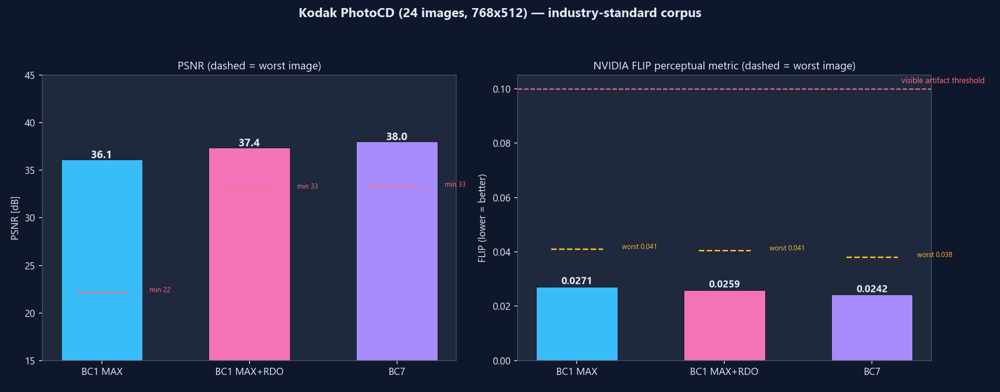
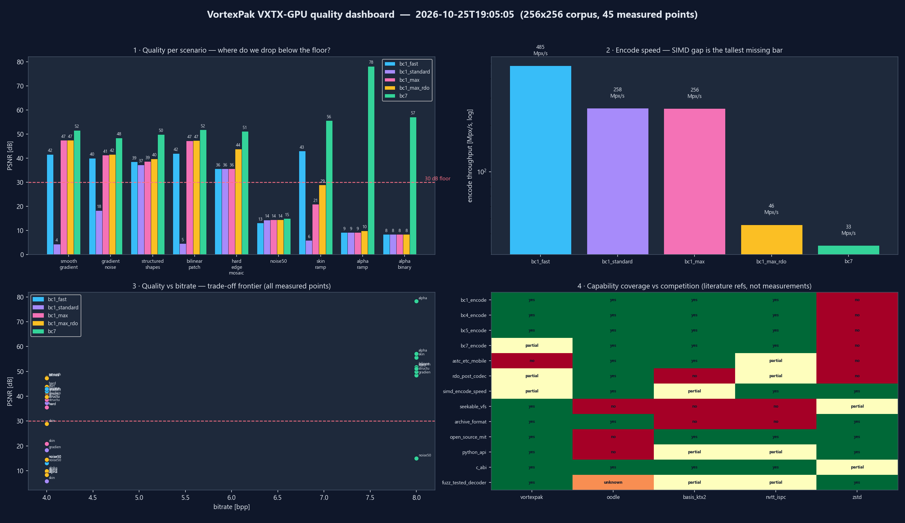
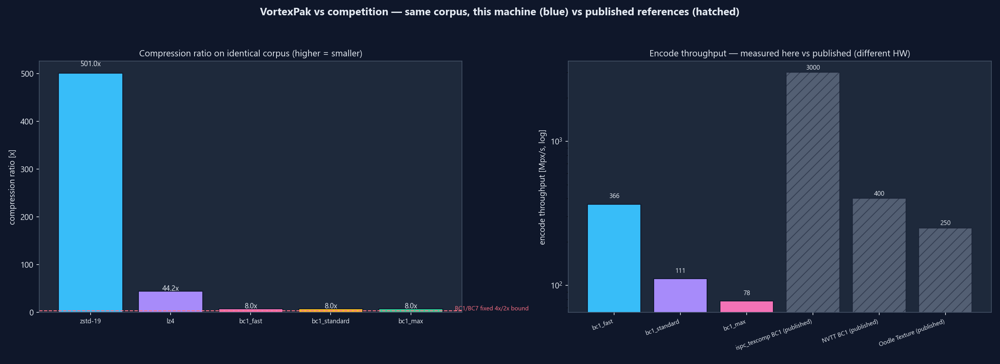
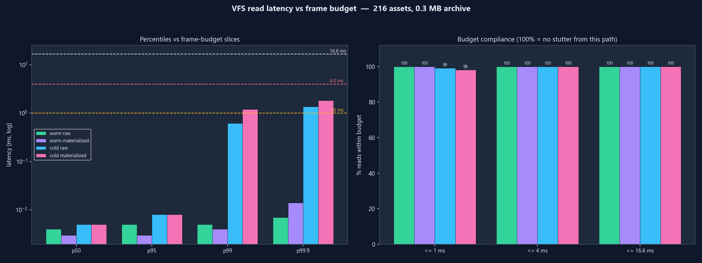
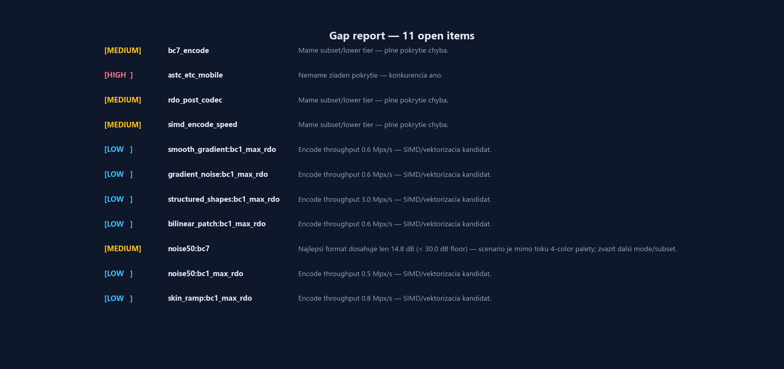

# VortexPak

**Format-aware game asset archiver, GPU texture codec and seekable VFS — Rust core, Python/C-ABI interface.**

[](https://github.com/ExTynT/vortexpak/actions/workflows/ci.yml)
[](LICENSE)

Packs a real game (**Xonotic, 2.47 GB / 14 597 files**) to **1.08 GB — smaller than zstd-19** (1.12 GB) while storing textures as GPU-ready BC1/BC7 blocks that upload to Direct3D/Vulkan/Metal without CPU-side decompression. Any single asset streams back in microseconds via the built-in VFS.

## Quick start

```powershell
pip install .          # builds the Rust core via cargo
vortexpak pack ./game game.vpak --gpu auto
vortexpak info game.vpak
vortexpak extract game.vpak textures/hero.png -o hero.png
```

```python
from vortexpak import VortexPakCodec, VortexVFS

arch = VortexPakCodec(mode="engine", gpu="auto").encode_directory("game/")
open("game.vpak", "wb").write(arch.to_bytes())

with VortexVFS.open("game.vpak") as vfs:
    blocks = vfs.read_bytes("textures/hero.png")   # GPU block data
```

## Measured results

Full-game pack of Xonotic 0.8.6 assets (identical corpus, identical machine — `python benchmarks/run_peak_game.py <game_dir>` reproduces):

| | VortexPak | zstd-19 (4T) | lz4 |
|---|---:|---:|---:|
| Archive size | **1 078 MB** | 1 117 MB | 1 491 MB |
| Compression ratio | **2.29×** | 2.21× | 1.66× |
| Pack time | 257 s | 314 s | 4 s |
| Full unpack | **0.9 s** | — | — |
| Random single asset (warm cache p99) | **6 µs** | — | — |
| Random single asset (cold p99) | 8.5 ms | — | — |

GPU texture lane (3 585 textures, 183 MB, `--gpu auto` = BC7 for alpha content, BC1 for opaque): **87.5 MB**, post-codec PSNR avg **37 dB**. Frame-budget read compliance: warm 100 % ≤ 1 ms, cold 99.75 % ≤ 16.6 ms.

**Note on the zstd baseline:** zstd compresses per file (as game pipelines do); VortexPak compresses as a solid archive with cross-file matching. Solid-mode zstd would close part of the gap.

### Kodak PhotoCD (industry-standard corpus)

24 images (768×512), the de-facto benchmark for texture codecs since the DXT era. PSNR + NVIDIA FLIP perceptual metric (lower = better; <0.10 = no visible artifact). Results directly comparable with published ISPC/Basis/NVTT numbers.

| Config | PSNR avg | PSNR worst | FLIP avg | FLIP worst | Speed |
|---|---:|---:|---:|---:|---:|
| BC1 MAX | 36.1 dB | 22.2 dB | 0.027 | 0.041 | 5.3 s |
| BC1 MAX + RDO | **37.4 dB** | **33.1 dB** | **0.026** | **0.041** | 21.6 s |
| BC7 (mode 6) | **38.0 dB** | 33.3 dB | **0.024** | **0.038** | 1.3 s |

All configurations are well below the 0.10 FLIP visible-artifact threshold. RDO improves worst-case PSNR by +10.9 dB over plain MAX.



### Charts

| Quality per scenario & capability gaps | vs competition (this machine + published refs) |
|---|---|
|  |  |

| VFS read latency vs frame budget | Open gaps |
|---|---|
|  |  |

Regenerate: `python benchmarks/quality_matrix.py && python benchmarks/generate_quality_charts.py`.

## How it works

1. **Format-aware lane packing** — assets are routed to semantic lanes (textures, structured data, scripts, media, 3D) sorted to maximize cross-file matches, then compressed with the proprietary **VXLZ-ANS** codec (Rust, Rayon-parallel) or zstd.
2. **Lane dictionaries** — repetitive text lanes get a dictionary trained on their own content ([format spec](docs/FORMAT.md) strategies 9/10); blocks are re-emitted as dictionary-seeded zstd frames only when measurably smaller. Random access preserved.
3. **VXTX-GPU block compression** — PNG/TGA/JPG → BC1 / BC5 / BC7(mode 6) blocks. Endpoint fit: exact 1D-segmentation DP + least-squares refinement (Giesen 2017), multi-axis seeding, exhaustive 565 snap polish; closed-loop RDO optimizes post-codec error. `--gpu auto` picks BC7 vs BC1 per texture by measured PSNR.
4. **Seekable VFS** — 16-block LRU cache, per-block decompression, XXH3-64 integrity on every asset. Corrupt archives raise clean errors — never crash (fuzz-tested decoder).
5. **C-ABI** — `vortexpak_native/vortexpak.h` (cbindgen-generated, CI-verified) exposes transforms, parallel decoders, BCn codecs and a native VFS for engines without Python ([examples/c/consumer.c](examples/c/consumer.c)).

## Current state & roadmap

Done: BC1/BC4/BC5/BC7(mode 6) encode+decode, RDO, auto format selection, lane dictionaries, VFS, hardened parser (58 Python + 26 Rust tests, adversarial fuzz), installable wheel, CI on 3 OS + pure-NumPy fallback.

| Gap | Status |
|---|---|
| SIMD encoder speed | MAX tier ~3 Mpx/s (scalar + Rayon); AVX2/ISPC planned — fast tier is 330+ Mpx/s |
| Full BC7 (partition modes) | mode 6 only today |
| ASTC/ETC (mobile) | not started — blocked on a reference-decoder conformance oracle |
| Cold-read tail | p99 8.5 ms — async prefetch / smaller blocks for streaming engines |

Full capability matrix vs Oodle/Basis/NVTT: `benchmarks/quality_matrix.py` → `quality_matrix.json` (auto-derived gap list).

## Repository layout

```
vortexpak/            Python package: codec.py (lanes/RDSO/dictionaries), vfs.py
                     (seekable VFS), bcn.py (GPU block compression), rdo.py,
                     native.py (ctypes bridge), cli.py
vortexpak_native/     Rust core: vxlz.rs (entropy codec), bcn.rs (BC1/4/5/7),
                     vxtx.rs (AVX2 transforms), decoder.rs, vfs.rs, rdo.rs,
                     c_api.rs -> vortexpak.h (cbindgen, CI-verified)
tests/                58 Python tests (native + fallback modes), incl. fuzz + E2E CLI
docs/FORMAT.md        VXPK container specification (strategies, lanes, dictionaries)
benchmarks/           quality_matrix.py (10-scenario gap table), run_peak_game.py,
                     chart generators; game corpora live OUTSIDE the repo
                     (--corpus / VORTEXPAK_CORPUS env var)
examples/c/           pure-C consumer of the native ABI
```

## Build & test

```powershell
cargo build --release --manifest-path vortexpak_native/Cargo.toml
pip install -e .
python -m unittest discover -s tests -v
cargo test --release --manifest-path vortexpak_native/Cargo.toml
```

Set `VORTEXPAK_DISABLE_NATIVE=1` to force the pure Python/NumPy fallback.

## License

[MIT](LICENSE)
